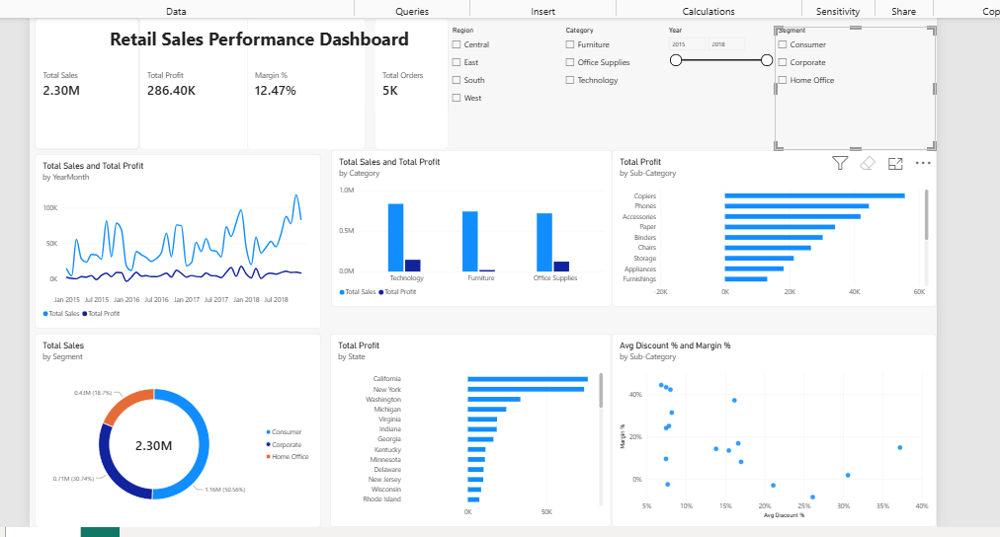

# Retail Sales Analytics: Final Capstone

An end-to-end analysis of 4 years of US retail orders: cleaning, EDA, visualisation, a Power BI dashboard and business recommendations. The goal was simple: find out where this business actually makes money and where it quietly loses it.

## Problem Statement
The business grew sales every year, but not every sale is a good sale. Which categories, regions and discount levels drive profit, and which ones drain it?

## Dataset
Superstore retail orders, Jan 2015 to Dec 2018: **9,994 order lines**, 793 customers, 1,862 products, 49 states, 21 original columns (order and ship dates, segment, region, category, sub-category, sales, quantity, discount, profit). The raw file (`data/superstore_raw.csv`) came with problems that needed cleaning.

## Tools Used
Python (pandas, NumPy, Matplotlib, Seaborn), Jupyter Notebook, Power BI Desktop (DAX), Git & GitHub, PowerPoint.

## Data Cleaning Process
| Issue found | Fix |
|---|---|
| 806 stray rows (People and Returns lookup tables pasted below the orders), 504 exact duplicates among them | Removed |
| 11 missing postal codes (Burlington, VT) | Filled from the city/state |
| Dates stored as text | Converted to datetime |
| Range checks (sales, quantity, discount, ship date >= order date) | All passed |
| New features | Year, Month, Ship Days, Profit Margin %, Loss Making flag |

Result: 9,994 clean rows, 0 missing values (`data/superstore_clean.csv`).

## Exploratory Data Analysis
Total sales **$2.30M**, profit **$286K**, margin **12.5%**, average order value **$459**, average discount **15.6%**. Discount vs margin correlation is **-0.86**, the strongest relationship in the data. About 11.7% of sales lines and 18.8% of profit lines are IQR outliers, mostly big-ticket machines and copiers. Full code and output in `analysis.ipynb`.

## Visualizations
| | |
|---|---|
|  |  |
|  |  |
|  |  |
|  |  |

## Power BI Dashboard


4 KPI cards, 6 visuals and Year / Region / Category / Segment slicers. Build steps and DAX measures are in [`powerbi/POWER_BI_GUIDE.md`](powerbi/POWER_BI_GUIDE.md).

## Key Insights
1. Sales up 51% and profit nearly doubled from 2015 to 2018.
2. Furniture is 32% of sales but only a 2.5% margin.
3. Tables (-$17.7K), Bookcases and Supplies lose money.
4. Discounts of 40%+ lost $99.6K across 933 orders.
5. Central region margin is 7.9% vs 14.9% in the West.

More detail in [`INSIGHTS.md`](INSIGHTS.md).

## Business Recommendations
1. Cap discounts at 20-30% with approval above that. Lines discounted 30%+ lost $135K.
2. Reprice or rationalise Tables and Bookcases.
3. Run a turnaround in Central (Texas, Ohio, Pennsylvania, Illinois).
4. Push high-margin lines: Copiers, Accessories, Paper, Labels.

## Conclusion
Growth is real, but a handful of deep discounts and two weak furniture lines are holding profit back. Fixing discount discipline alone could lift profit by close to half.

## Repo Structure
```
├── README.md
├── INSIGHTS.md
├── analysis.ipynb
├── requirements.txt
├── data/        raw + clean CSV
├── charts/      8 PNG charts
├── powerbi/     guide, .pbix, dashboard screenshot
└── presentation/
```
